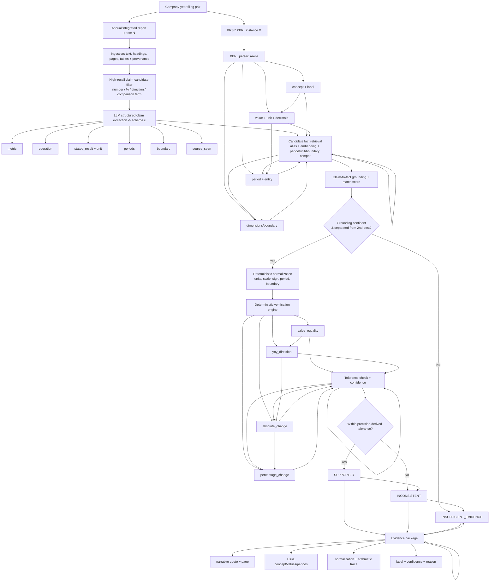

# Evidence-Grounded Verification of Quantitative BRSR Claims — Research Plan v2

> **Status:** Planning / problem-understanding stage. This document supersedes `BRSR_Project_Rescope (1).md`.
> **Purpose:** Define the problem and the solution precisely, ground both in an exhaustive and *verified* literature survey, expose the gaps in v1, and set us up to implement and publish. No timelines. No hallucinated citations — every reference below was checked against a live source and linked.
> **Working system name:** **VeriBRSR**. **Working dataset name:** **BRSR-Claim** (a labeled corpus of quantitative claims paired to structured facts).

---

## 0. TL;DR — the raw verdict

The idea is **publishable and genuinely novel in a narrow, defensible way.** The novelty is *not* "verify claims with an LLM" (done to death) and *not* "detect greenwashing" (subjective, crowded). The novelty is the **specific, unoccupied intersection**:

> **Explainable verification of *derived* quantitative claims (percentages, year-over-year directions, absolute/relative changes) stated in Indian BRSR narrative prose, grounded in the company's own machine-readable XBRL facts, using a deterministic calculator and calibrated abstention — plus the first labeled dataset for this task.**

Every adjacent thing exists (FEVER-style fact verification, FinDVer for financial docs, FinVerBench/AuditFlow for XBRL numeric consistency, greenwashing NLP for ESG prose). **Nobody has published the BRSR × narrative-derived-claim × XBRL-grounding × deterministic-verify × abstention × labeled-dataset combination.** That gap is real and confirmed by search. This document builds the paper around that gap and around the *one honest scientific risk* v1 hand-waved (see §6).

---

## 1. Problem definition

### 1.1 The concrete situation

India's top 1,000 listed companies must file a Business Responsibility and Sustainability Report (BRSR). As of FY 2025–26 this is filed **twice, on the same day**: as human-readable prose inside the annual report (PDF), and as a **machine-readable XBRL instance** where every quantitative disclosure is tagged. The XBRL values, for the nine BRSR Core attributes, must match the third-party assured figures exactly ([NSE XBRL filing information](https://www.nseindia.com/static/companies-listing/xbrl-information); [BRSR-XBRL FY25-26 readiness](https://ecodrisil.com/preparing-for-brsr-xbrl-filing-fy-2025-26-data-readiness-assurance-challenges/); [SEBI BRSR Core framework, 2023](https://www.sebi.gov.in/legal/circulars/jul-2023/brsr-core-framework-for-assurance-and-esg-disclosures-for-value-chain_73854.html)).

So for every large Indian company we now have, by regulation, a **guaranteed pair**: prose narrative + structured facts about the *same* sustainability metrics. That pairing is the substrate that makes this project feasible — and it did not reliably exist before FY 2025–26.

### 1.2 What actually goes wrong (and why it's worth a paper)

A reviewer, investor, or assurance provider reads a sentence like:

> *"Our water consumption decreased by 20%, from 100 ML in FY24 to 78 ML in FY25."*

100 → 78 is a **22% decrease**, not 20%. Or the prose says "reduced" while the disclosed values rose. Or the percentage is computed against the wrong base year, or a different reporting boundary (standalone vs consolidated), or a units mismatch (kL vs ML). These are not fraud — they are the ordinary arithmetic-and-transcription errors that creep into hand-written sustainability prose. Catching them by hand means: locate the metric, confirm period and boundary, normalize units, redo the math, and keep evidence. Slow, boring, and exactly what a machine should do.

### 1.3 Formal task statement

**Input:** a company-year filing pair `(N, X)` where `N` is narrative text (with page/section provenance) and `X` is the XBRL instance (facts with concept, value, unit, period, entity, dimensions).

**Step 1 — Claim extraction.** From `N`, extract a set of *explicit, testable quantitative claims* `c`, each a structured tuple:
`c = (metric, operation, stated_result, unit, period_current, period_compare, boundary, source_span)`
where `operation ∈ {value_equality, yoy_direction, absolute_change, percentage_change}`.

**Step 2 — Evidence grounding.** Map `c` to the supporting XBRL fact(s) in `X`.

**Step 3 — Verification.** Deterministically recompute the claimed relationship from the grounded facts and assign a label:
`y ∈ {SUPPORTED, INCONSISTENT, INSUFFICIENT_EVIDENCE}`
(the three-way FEVER label space — *Supported / Refuted / NotEnoughInfo* — specialized to numbers).

**Output:** `(y, evidence_package)` where the evidence package contains the narrative quote + page, the XBRL concept/values/periods, the normalization steps, and the arithmetic trace. **An unexplained label is a failed output.**

### 1.4 Scope — what this is and is NOT

**In scope**
- Public BRSR filings of Indian listed entities; English prose + the paired XBRL instance.
- A **controlled metric set**, done deeply: water, energy, Scope 1 & Scope 2 emissions, waste, workforce/employee counts, gender representation.
- Four claim operations: value equality, YoY direction, absolute change, percentage change.
- Deterministic unit normalization and arithmetic (LLM extracts language; **LLM never does the final math**).
- Evidence-linked outputs and **calibrated abstention** when grounding is ambiguous or evidence is missing.
- A labeled corpus (**BRSR-Claim**): naturally occurring claims + separately flagged controlled perturbations.

**Explicitly OUT of scope (and we say so loudly — it is a strength, not a weakness)**
- Fraud, intent, deception, legal non-compliance, or "greenwashing" attribution. A number mismatch is a *flag for human review*, not a finding of misconduct.
- Vague/aspirational prose with no testable quantity ("we made remarkable progress").
- External verification against news, satellite, sensors, invoices, other companies.
- Cross-company ranking, ESG scoring, investment advice, forecasting.
- OCR-heavy scanned filings; full semantic resolution of every XBRL dimension.
- Replacing an assurance provider. VeriBRSR is a **reviewer-assistance** tool.

---

## 2. Positioning: this is a *numerical claim-verification* problem, not a "financial contradiction" problem

**This is the single biggest reframing vs v1.** v1 positioned the work against "LLM contradiction detection in financial reports" — a framing that (a) made the work look derivative of Deußer et al. 2023 and (b) *missed the entire academic lineage this work actually belongs to.* The correct academic home is **automated fact verification / claim verification**, a mature NLP subfield with a standard task shape (claim + evidence → Supported/Refuted/NEI + rationale). Reframing this way gives us a cleaner novelty story, stronger related work, and reviewers who already understand the task.

The lineage, in families:

### Family A — General fact verification (the ancestor)
| Work | What it established | Distance from us |
|---|---|---|
| **FEVER** (Thorne et al., 2018) | The canonical claim → *Supported/Refuted/NotEnoughInfo* task over Wikipedia ([paper](https://aclanthology.org/W18-5501/)). | Text-only, no numeric grounding, no structured evidence. We inherit its 3-way label space. |
| **FEVEROUS** (Aly et al., 2021) | Extended FEVER to **tables + text**; explicitly noted numerical reasoning is under-served (~10% of claims) ([paper](https://datasets-benchmarks-proceedings.neurips.cc/paper/2021/file/68d30a9594728bc39aa24be94b319d21-Paper-round1.pdf)). | Wikipedia tables, synthetic claims; numeric reasoning is a gap it names but doesn't solve. |

### Family B — Numerical / temporal / structured claim verification (the direct parents)
| Work | What it established | Distance from us |
|---|---|---|
| **TabFact** (Chen et al., 2019) | Verifying claims against Wikipedia tables (entailment). | General-domain tables, no unit/period normalization, no abstention. |
| **QuanTemp** (Venktesh et al., 2024) | *First* open-domain benchmark for fact-checking **numerical claims** with temporal reasoning ([arXiv 2403.17169](https://arxiv.org/pdf/2403.17169)). | Open-domain fact-check-website claims; evidence is web text, not the entity's own structured filing. |
| **TSVer** (2025) | Fact verification against **time-series evidence**, numerical+temporal ([arXiv 2511.01101](https://arxiv.org/html/2511.01101)). | Time-series evidence, not regulatory XBRL facts. |
| **ClaimDB** (2026) | Fact verification over **large structured data** ([arXiv 2601.14698](https://arxiv.org/pdf/2601.14698)). | Generic structured DBs, not narrative-to-XBRL, not ESG. |
| **ClimateViz** (2025) | Statistical reasoning + fact verification over **scientific charts** ([arXiv 2506.08700](https://arxiv.org/html/2506.08700)). | Charts, climate science; not corporate disclosure. |

### Family C — Financial claim verification & neuro-symbolic numeric checking (the closest cousins)
| Work | What it established | Distance from us |
|---|---|---|
| **FinQA** (Chen et al., 2021) | Numerical reasoning over financial reports via executable programs; big model-vs-expert gap ([ACL Anthology](https://aclanthology.org/2021.emnlp-main.300/)). | QA, not verification; motivates explicit inspectable calculation. |
| **TAT-QA** (Zhu et al., 2021) | QA over hybrid table+text finance; TAGOP F1 58.0 vs human 90.8 ([ACL Anthology](https://aclanthology.org/2021.acl-long.254/)). | QA, not contradiction; supports hybrid symbolic design. |
| **FinDVer** (Zhao et al., 2024) ⚠️ **closest ancestor — v1 missed this entirely** | *First* context-grounded **explainable claim verification** benchmark for finance; subsets for info-extraction, numerical reasoning, knowledge; best LLM (Claude-3.5-Sonnet) **77.2%** vs experts **93.3%** ([arXiv 2411.05764](https://arxiv.org/abs/2411.05764)). | US financial reports (10-K/10-Q), no XBRL grounding, no unit-normalized deterministic engine, no Indian/ESG angle, no calibrated abstention as a first-class output. **We must differentiate against this in the intro (see §5).** |
| **FinVerBench** (2026) | Perturbation-based **numerical consistency** verification of financial statements; shows rounding/observability/prompt design dominate false positives ([arXiv 2605.29586](https://arxiv.org/pdf/2605.29586)). | Internal statement consistency, not narrative-to-fact; its calibration findings directly shape our tolerance rules. |
| **AuditFlow** (2026) | **Neuro-symbolic**: LLM decides *where to look*, a symbolic environment does fact retrieval + numeric checks over XBRL ([arXiv 2606.03031](https://arxiv.org/html/2606.03031)). | Architecturally near-identical philosophy — *validates our design* — but US audit rules, not ESG/BRSR narrative claims. |
| **FinAuditing / FinTagging** (2025) | XBRL tagging + multi-doc audit benchmarks; accuracy collapses on hierarchical multi-doc structures; >6,500 real tagging errors in one year ([FinTagging arXiv 2505.20650](https://arxiv.org/pdf/2505.20650)). | Tagging & internal audit, not claim-to-narrative verification. |
| **AuditFraudBench** (2026) | Enforcement-grounded **fraud judgment** over restated filings + AAERs ([arXiv 2606.08345](https://arxiv.org/pdf/2606.08345)). | Fraud attribution — the thing we deliberately refuse to do. |

### Family D — ESG / greenwashing NLP (the domain neighbors)
| Work | What it established | Distance from us |
|---|---|---|
| **Deußer et al.** (2023) | LLM contradiction detection in financial reports via paragraph clustering ([paper](https://publica-rest.fraunhofer.de/server/api/core/bitstreams/ff5b4b84-0943-40ab-9548-7c4e9e71330f/content)). | Generic, unstructured, no deterministic grounding — makes *generic* "LLM finds contradictions" non-novel, which is why we go structured + deterministic + dataset. |
| **A3CG — Robust ESG analysis** (2025) | Aspect–action pairs, cross-category generalization; first dataset for greenwashing-robust ESG analysis ([arXiv 2502.15821](https://arxiv.org/html/2502.15821v1)). | Subjective aspect/action semantics, not numerical consistency. |
| **Enhancing LMs for Robust Greenwashing Detection** (2026) | Shows greenwashing models rely on surface lexical cues, generalize poorly; scale doesn't fix it ([arXiv 2601.21722](https://arxiv.org/html/2601.21722)). | Confirms *subjective* greenwashing is brittle — our objective, arithmetic task sidesteps this entirely. |
| **Greenwashing detection survey** (Calamai et al., 2025) | Field survey; notes lack of standard definition + scarce labeled data ([arXiv 2502.07541](https://arxiv.org/abs/2502.07541)). | Motivates an *objective, reproducible* alternative to subjective labels. |
| **LLM EU-Taxonomy KPI extraction** (2025) | LLMs to extract/predict EU-Taxonomy KPIs from sustainability reports ([arXiv 2512.24289](https://arxiv.org/pdf/2512.24289)). | Extraction/prediction, not verification against the firm's own structured facts. |
| **"Evaluating AI's Ability to Analyse Sustainability Reports"** (Poutiainen, 2026, MSc thesis) ⚠️ **the closest BRSR-specific work** | Feeds BRSR PDF **and** XBRL to GPT-4o on **19 reports**; compares structured vs unstructured input ([thesis PDF](https://fi.xbrl.org/wp-content/uploads/sites/17/2026/05/Gradu-Poutiainen.pdf)). | Descriptive "can the LLM analyze?", tiny scale, **no verification pipeline, no deterministic engine, no dataset, no abstention, not peer-reviewed.** This is the strongest proof both that BRSR+XBRL is workable *and* that the verification problem is wide open. |

### Family E — Regulatory grounding (context, not algorithms)
- [SEBI BRSR Core framework, 2023](https://www.sebi.gov.in/legal/circulars/jul-2023/brsr-core-framework-for-assurance-and-esg-disclosures-for-value-chain_73854.html) and the [Dec 2024 review](https://www.sebi.gov.in/sebi_data/meetingfiles/dec-2024/1735040682024_1.pdf): BRSR Core, phased assurance/**assessment** glide path. (Say "assessment **or** assurance" — v1 was right to flag the outdated "assurance-only" claim.)
- [NSE BRSR XBRL circular, 2023](https://nsearchives.nseindia.com/web/sites/default/files/inline-files/NSE_Circular_24022023.pdf) and [NSE XBRL filing page](https://www.nseindia.com/static/companies-listing/xbrl-information): the XBRL submission mechanism.

### 2.1 The gap, stated as one sentence a reviewer will accept
> No published, peer-reviewed system or dataset verifies **explicit derived quantitative claims** made in **Indian BRSR narrative prose** against the company's own **structured BRSR/XBRL facts**, with **deterministic recomputation, unit/period/boundary normalization, calibrated abstention, and full evidence traces.** FinDVer is the closest, but it is US-financial, non-XBRL-grounded, non-ESG, and does not treat abstention or unit-normalization as first-class. That is our lane.

---

## 3. What v1 got wrong or missed — the gap analysis

This is the honest audit of `BRSR_Project_Rescope (1).md`. v1 is a solid *project spec* but a weak *paper plan*. Concretely:

1. **Missed the fact-verification lineage entirely (critical).** v1's related work is only finance + greenwashing + regulation. It never mentions FEVER/FEVEROUS/TabFact/QuanTemp/**FinDVer**. A competent reviewer will surface FinDVer in five minutes and ask "how is this not FinDVer for ESG?" → v2 answers this head-on (§5).
2. **No engagement with the strongest cousin, FinDVer, or the neuro-symbolic AuditFlow.** v1 can't claim novelty against work it doesn't cite. v2 cites and differentiates.
3. **The narrative-source problem is unaddressed (feasibility risk).** v1 says claims come from "BRSR narrative." But BRSR is itself a semi-structured form; the *prose* derived claims ("fell 20%") mostly live in the **Chairman/MD&A letters, the integrated/ESG report sections, and the qualitative fields of BRSR Section C**, not the numeric BRSR tables. v2 makes claim provenance explicit and widens the narrative source to "the annual/integrated report prose surrounding the BRSR" (still English, still public).
4. **The circularity/triviality risk is under-treated (the core scientific risk).** Because XBRL values are typed from the same annual report, a *raw value-equality* claim ("water was 78 ML") will almost always match the XBRL trivially → boring, near-zero natural inconsistency, weak paper. v2 **re-centers the contribution on *derived* claims** (percentages, directions, YoY, absolute change), where the *stated arithmetic in prose* is what's error-prone and where the XBRL raw values are the independent ground truth. This is the difference between a trivial string-match paper and a real verification paper. (See §6 — this is non-negotiable.)
5. **Reads like a spec, not a paper.** No crisp "contributions" list, no task formalization in the standard claim-verification frame, no differentiation paragraph. v2 fixes framing so it can be dropped into a paper intro.
6. **Baselines omit the actual state of the art.** v1's baselines (majority, keyword, naive prompt, retrieval+LLM) are fine but don't include a **long-context LLM verifier (FinDVer-style)** or a **neuro-symbolic ablation (AuditFlow-style)**. v2 adds them so the comparison is credible.
7. **Over-broad metric set spread thin.** Six metric families shallow < three done deeply. v2 recommends depth-first (water, energy, Scope 1&2) with the rest as extension.

What v1 got **right** and v2 keeps unchanged: the deterministic-engine-not-LLM-math principle; the three-way label space; calibrated abstention; company-level splits to prevent leakage; double annotation + Cohen's κ; the reviewer-assistance (not fraud) ethical framing; the strong metric suite (precision-first, risk–coverage, McNemar's, ablations). These are genuinely above the bar for the target venues — keep them.

---

## 4. The solution — architecture



**Design principles (each traceable to the literature):**
- **LLM extracts language; symbolic engine does math.** The LLM produces the *claim schema* and *candidate grounding*; it never computes the final percentage or renders the verdict. Motivated by FinDVer/FAITH-style collapse of LLM numeric reasoning and by AuditFlow's search-vs-computation split.
- **Grounding is retrieval + compatibility, with a separation margin.** A weighted match score, e.g. `0.40·metric + 0.20·period + 0.15·unit + 0.15·boundary + 0.10·section_context`, tuned only on dev. Verify only if best match clears a calibrated threshold *and* beats the second-best by a margin; else abstain.
- **Normalization is explicit and deterministic.** kL↔L, tonnes↔kg, GJ↔MJ, lakh/crore scales, commas, parenthetical negatives, intensity denominators, fiscal-year aliases. Incompatible boundaries/denominators are never compared — they abstain. (Directly answers FinVerBench's finding that rounding/observability drive false positives.)
- **Tolerance derived from displayed precision**, not learned on test: start ±0.5 percentage-points for displayed percentages, ±1% relative for values; calibrate on dev only.
- **Abstention is a first-class output**, reported on a risk–coverage curve — this is a key differentiator vs FinDVer, which treats verification as forced-choice classification.
- **Explanations are template-filled from the verified trace.** An LLM may only *reword*, and only if its wording is checked back against the trace.

---

## 5. The differentiation paragraph (drop-in for the paper intro)

> Prior context-grounded claim-verification benchmarks are either general-domain (FEVER, FEVEROUS, TabFact), numerically oriented but web-evidenced (QuanTemp, TSVer), or financial but US-centric and non-XBRL-grounded (FinDVer, FinQA, TAT-QA). Neuro-symbolic financial verifiers (AuditFlow, FinVerBench) operate on internal statement consistency and US audit rules rather than narrative-to-disclosure agreement, and fraud benchmarks (AuditFraudBench) attempt intent attribution we deliberately avoid. ESG NLP work targets *subjective* greenwashing cues (A3CG, Calamai et al. 2025) whose labels are contested and brittle. VeriBRSR occupies the unclaimed intersection: **objective, reproducible verification of *derived* quantitative claims in Indian BRSR narrative against the firm's own regulatorily-mandated XBRL facts, with deterministic recomputation, unit/period/boundary normalization, calibrated abstention, and evidence traces — accompanied by BRSR-Claim, the first labeled dataset for the task.**

---

## 6. The one risk that decides whether this is a real paper (read twice)

**Circularity / triviality of value-equality claims.** Since the annual-report prose and the XBRL are produced from the *same* internal data, a claim that merely *restates* a raw disclosed number ("water consumption was 78 ML") will match the XBRL almost always → natural inconsistency rate ≈ 0 → nothing to verify → not a paper.

**The fix (this is the intellectual core of v2):** center the contribution on **derived claims** — statements that assert a *relationship computed in prose*: a percentage change, a direction ("reduced"), a YoY delta, an absolute change. Humans compute these by hand in the narrative; the XBRL stores only the *raw* values. The percentage in the sentence is therefore an *independent human computation* that can — and empirically does — disagree with what the raw XBRL values imply. That disagreement is the signal. VeriBRSR's job is to recompute the relationship from raw XBRL and check the prose's arithmetic. This is genuinely non-trivial, genuinely useful, and genuinely under-studied.

**Consequences for the dataset:**
- Report the **natural inconsistency prevalence honestly.** If real derived-claim errors are rare, that is itself a finding — and it is *why* controlled perturbations exist.
- **Controlled perturbations** (reverse a direction, alter a percentage, swap a base year, change a magnitude/unit) are built *only from human-confirmed supported claims*, one minimal edit at a time, each human-checked to be grammatical, unambiguous, and truly inconsistent. Store `synthetic=true`, mutation type, source claim id. **Never merge synthetic items into the natural test distribution to fake a real-world contradiction rate.** Report natural and synthetic subsets separately, always.
- The paper's headline is not "we find lots of lying companies" (we don't, and we don't claim to). It's "**we can reliably recompute and check the derived quantitative claims humans write in ESG prose, we know when to abstain, and a deterministic-grounded pipeline beats naive LLM prompting on precision and false-positive rate.**"

---

## 7. Dataset — BRSR-Claim

**Target (paper-scale, not dissertation-scale):** ~**150–300 eligible claims** from **30–60 company-year filings**, depth-first on water / energy / Scope 1&2 (extend later). At least ~**100 naturally occurring claims double-annotated**; controlled perturbations balance the operation/label mix without polluting the natural test set.

**Each record:** company + FY; narrative span + page/section + source id; eligibility + operation; canonical metric, stated values/periods/units/boundary; linked XBRL concept(s)/contexts/values/units/location; gold normalization + arithmetic trace; gold label (SUPPORTED / INCONSISTENT / INSUFFICIENT_EVIDENCE); ambiguity/adjudication note; natural/synthetic flag + mutation type.

**Protocol:** two independent annotators per dev/test item; a third adjudicates blind to system output. Report **Cohen's κ** for the categorical label (target ≥ 0.80 — if lower, the task definition is unstable and must be revised before evaluation) and field-level F1/exact-match for extraction. **Split by company** (no company spans train/dev/test); check near-duplicate boilerplate across splits. Human-confirmed labels only — **never** use model output as gold.

---

## 8. Evaluation

**Baselines (v2 adds the two v1 omitted):**
1. Majority / always-SUPPORTED.
2. Keyword + nearest-number arithmetic (no semantic mapping, no LLM).
3. Naive LLM prompt (passage + filing content, "do they contradict?").
4. Retrieval + LLM (LLM does grounding *and* math).
5. **Long-context LLM verifier (FinDVer-style)** — whole report + claim, forced-choice. *(new)*
6. **Neuro-symbolic ablation (AuditFlow-style)** — LLM grounds, symbolic engine computes, but *no* calibrated abstention. *(new)*
7. **VeriBRSR (proposed):** structured extraction + retrieval grounding + deterministic normalization/calculation + calibrated abstention + evidence.

Freeze model names/versions, prompts, temperature, decoding, thresholds, and normalization tables **before** touching the test set. Log cost/retries/date.

**Metrics:** INCONSISTENT precision (≥0.85 combined, ≥0.80 natural — the reviewer-trust number), recall (≥0.75, per mutation type reported), F1 (≥0.80 and a *statistically supported* win over naive prompting), false-positive rate on supported-natural (≤10%, stretch 5%), 3-class macro-F1 (≥0.75), extraction field-F1 (≥0.85), grounding top-1 (≥0.85), evidence completeness (≥0.95 on non-abstained), **calculation accuracy given gold facts (≥0.98 — below this is an engineering bug, not a research result)**, abstention coverage (≥0.70 without breaking the precision target), selective risk (risk–coverage curve, threshold chosen on dev), calibration (ECE/Brier, must beat raw LLM confidence), latency/cost (median <10 s/claim, documented student budget).

**Ablations (each removes one component):** deterministic calculation, unit normalization, period filtering, boundary filtering, abstention. This is what proves the architecture beats a prompt wrapper. Use paired bootstrap CIs over claims and **McNemar's** for end-to-end decision errors; report effect sizes and CIs, not just p-values.

---

## 9. Contributions (the paper's claims, ranked by defensibility)

1. **BRSR-Claim** — the first labeled dataset for verifying derived quantitative claims in Indian BRSR narrative against paired XBRL facts, with evidence traces and controlled perturbations. *(A dataset alone clears the bar at the target venues.)*
2. **VeriBRSR** — a neuro-symbolic pipeline (LLM extraction/grounding + deterministic normalization/verification + calibrated abstention) that beats naive-LLM and long-context baselines on INCONSISTENT precision and false-positive rate.
3. **An abstention/calibration study** on regulatory ESG claims — risk–coverage and ECE analysis showing when the system should decline.
4. **An honest empirical characterization** of how often derived quantitative claims in real Indian BRSR prose disagree with the firm's own XBRL (with the circularity caveat stated openly).

We do **not** claim: that claim verification, numerical reasoning, or ESG-language analysis is new; that we detect fraud/greenwashing; that a mismatch proves misconduct.

---

## 10. Minimal implementation stack (planning-level; unchanged where v1 was right)

Python 3.11+, Git, `venv`/Conda. pandas/NumPy/Pydantic + SQLite/DuckDB. PyMuPDF/pdfplumber + BeautifulSoup/lxml for ingestion (OCR excluded from the evaluated core). **Arelle + lxml** for XBRL (contexts, units, concepts, dimensions). spaCy / sentence-transformers / scikit-learn for candidate filtering, embeddings, retrieval, classical baselines. One frozen budget-controlled API model *or* a local 7B–14B instruct model for extraction only. `decimal` + Pint + explicit project rules for deterministic math. Label Studio/Doccano for annotation. FastAPI + minimal Streamlit for the evidence-card demo (UI is *not* the contribution). pytest/Ruff/mypy — parser/normalization/calculation correctness is a research requirement, not hygiene. Versioned CSV/JSON + DVC (or MLflow) for prompts/versions/thresholds/splits/results. matplotlib for confusion matrices and risk–coverage curves. No vector DB, no Kubernetes, no blockchain, no GPU cluster. Cache everything by content hash; use the LLM only on shortlisted candidates; public filings only, no secrets in the repo.

---

## 11. Venue reality (brief — you said publish anywhere good)

- **Framing for an NLP/data venue:** "explainable numerical claim verification, new dataset, neuro-symbolic pipeline, abstention" — the FEVER/FinDVer framing travels well to applied-NLP tracks, workshops (FinNLP, ClimateNLP-style), and Scopus-indexed Springer conferences (LNNS/LNEE). A dataset + system + ablations paper is a natural 8–12 page conference submission.
- **Framing for a sustainability/infrastructure venue** (e.g. an ICIDS-type "sustainability + ICT" track): lead with the SEBI/BRSR regulatory motivation and reviewer-assistance value; the sustainability angle fits better there than a pure smart-energy venue.
- **The bar at these venues is: real task + real (even small) dataset + honest evaluation + clear delta.** This plan clears it *if* §6 (derived claims, honest prevalence) is respected. The failure modes are (a) trivial value-equality string-matching dressed up as verification, (b) claiming greenwashing/fraud detection, (c) an undcited FinDVer. v2 closes all three.

---

## 12. Immediate next steps (still planning stage — no dates)

1. **Feasibility probe (make-or-break):** pull 20–30 real FY2024–25/2025–26 filing pairs from NSE/BSE; confirm (a) XBRL parses with Arelle and exposes water/energy/Scope1&2 with periods+units+dimensions, (b) the surrounding prose actually contains *derived* quantitative claims, and (c) at least a handful of natural mismatches or near-misses exist. If derived claims are too sparse, widen the narrative source (integrated report, MD&A) before touching the metric set.
2. **Freeze the claim schema and the three label definitions** with 2–3 worked examples each (incl. the "78 ML but claims 20%" canonical case).
3. **Write the annotation manual** (positive/negative/ambiguous/target-future/rounded/restated/intensity/consolidated-vs-standalone/missing-evidence), then a **30–50 claim pilot** all annotators label independently; iterate until κ is acceptable.
4. **Build the Arelle-based fact index + BRSR concept dictionary** (taxonomy label + textual aliases → canonical metric) and the deterministic normalizer, with unit tests validated against the displayed filing.
5. **Stand up the deterministic verification engine first** (it's the reproducible core; target ≥0.98 given gold facts) *before* wiring the LLM extractor — so the LLM is measured against a known-correct calculator.

---

## 13. Data acquisition — exactly how to get the raw material (do every step literally)

### 13.1 First, the blunt truth about "the dataset"
There are **two different things** and people constantly confuse them:

| | Exists? | Downloadable? | Who makes it |
|---|---|---|---|
| **BRSR-Claim** (labeled claims + gold labels + evidence traces) | **No. Does not exist anywhere.** | No | **You build it.** This is the paper's contribution. |
| **Raw filings** (BRSR narrative PDF + XBRL instance) | **Yes, for the top ~1,000 listed firms** | **Yes, free** | SEBI-mandated; hosted by NSE/BSE |

So "checking if the dataset is available" = checking if the **raw filings** are available. They are. You then do the intellectual work (extract → ground → label → adjudicate) that turns raw filings into BRSR-Claim. Do **not** go looking for a ready-made "BRSR claim verification dataset" — there isn't one, and that's the point.

### 13.2 What you need to collect, per company-year
For each company `i` and financial year `y` you need a **pair**:
1. **Narrative** — the BRSR + surrounding prose (Chairman/MD&A/ESG chapters). This lives inside the **Annual Report PDF** (BRSR is an annexure to it) and/or a standalone BRSR PDF.
2. **Structured facts** — the **BRSR XBRL instance** file (`.xml`) for the same company-year.
3. **(Once, globally)** the **BRSR XBRL taxonomy** files — the schema that tells you what each XBRL tag *means*. You need this to interpret the instance. Downloaded once, not per company.

Target for a first paper: **30–60 pairs** (see §7). You do NOT need all 1,000.

### 13.3 Source ranking (use in this order)
1. **BSE India** — easiest for manual PDF + has a dedicated XBRL section; deepest history. **Start here.**
2. **NSE India** — has a clean "Annual Reports (XBRL)" listing, but the site is JS-heavy and **actively blocks automated fetching** (I hit a timeout loading it during this research — expect the same; download manually in a browser).
3. **Company Investor-Relations page** — almost always hosts the BRSR/annual report PDF; good for the narrative, rarely gives you the XBRL instance.
4. **SEBI filing database** — backup search by company.
5. **MCA portal** — backup for older/delisted companies (needs a free account + the company CIN).

### 13.4 Step-by-step — BSE (do this first, it's the least painful)
**A. Get the narrative PDF**
1. Open `https://www.bseindia.com`.
2. In the top search bar, type the company name (e.g. "Infosys"). Click the matching result → you land on the company page.
3. Note the **BSE scrip code** (a 6-digit number in the URL/page, e.g. Infosys = 500209). Keep this — it's the company's unique BSE id for your inventory.
4. Open the **"Financials"** tab (or **"Corporate Announcements"**). Annual Reports are filed as PDF attachments.
5. Pick the financial year (e.g. 2024–25). Click the PDF link → it downloads.
6. Inside the PDF, find the **"Business Responsibility and Sustainability Report"** section (usually an annexure, often 20–40 pages, with Section A/B/C). That's your narrative source.

**B. Get the XBRL instance**
1. On the same BSE company page, look under **Corporate Announcements / XBRL** or the announcement category that includes BRSR (BRSR is filed the *same day* as the annual report).
2. BSE's XBRL landing is `https://www.bseindia.com/corporates/xbrldetails` and the XBRL info page is `https://www.bseindia.com/static/about/xbrl_info.aspx`.
3. Download the `.xml` XBRL instance for the BRSR filing for that company-year. Save it next to the PDF.
4. If you only find the PDF and not the instance on BSE, get the instance from NSE (§13.5) — the utility is cross-compatible, so the same company will have an equivalent instance on either exchange.

### 13.5 Step-by-step — NSE (do this in a real browser, not a script)
1. Open `https://www.nseindia.com/companies-listing/corporate-filings-annual-reports-xbrl` (the dedicated **Annual Reports in XBRL** listing).
2. Search by company name or **NSE symbol** (e.g. INFY). Record the symbol for your inventory.
3. The table shows filing date + a download link per company-year. Click to download the **XBRL** file. For the PDF, use the **"Corporate Filings → Annual Reports"** section and pick the year.
4. NSE also has a dedicated **Business Sustainability Reports** area under corporate filings — check there for the BRSR-specific XBRL if the annual-reports listing doesn't expose it.
5. **Operational warning (real):** NSE blocks bare HTTP requests. If you script it, you must first hit the NSE homepage to obtain session cookies, send a browser `User-Agent`, and throttle hard — or you'll get blocked/timeouts. For 30–60 filings, **just download by hand.** Only build a scraper if you scale to hundreds, and even then respect their robots/rate limits.

### 13.6 Get the taxonomy (once) so the XBRL is interpretable
1. Go to the NSE XBRL information page: `https://www.nseindia.com/static/companies-listing/xbrl-information`.
2. Download the **BRSR taxonomy** (schema `.xsd` + linkbases) and the **filing manual / business rules** if provided. BSE's `xbrl_info.aspx` has equivalents.
3. Also grab **NSE's 38 sector-specific BRSR guides** and the BRSR filing FAQ circular ([NSE/CML/2024/11, 10 May 2024](https://nsearchives.nseindia.com/web/sites/default/files/inline-files/NSE_Circular_10052024_1.pdf)) — these define what each disclosure means, which you need when writing the concept dictionary and annotation manual.

### 13.7 Parse and verify the XBRL (tooling)
1. `pip install arelle-release` (the maintained Arelle package) — or use the Arelle GUI.
2. Load the instance `.xml` **with the taxonomy**; Arelle exposes every *fact* as `(concept/QName, value, unit, decimals, contextRef)` and each `context` as `(entity, period, dimensions)`.
3. Sanity-check: for 2–3 filings, open the PDF, find "Total water consumption FY25", and confirm the same number appears as a fact in the XBRL with the right unit/period. If it doesn't parse or numbers don't line up, fix parsing **before** scaling.
4. Export facts to a flat table (`company, fy, concept, value, unit, period, dimensions, source_file`). This becomes the structured side of every record.

### 13.8 The known aggregate reality check
The closest prior work ([Poutiainen 2026 thesis](https://fi.xbrl.org/wp-content/uploads/sites/17/2026/05/Gradu-Poutiainen.pdf)) reports NSE hosting **~1,182 BRSR filings for FY2023–24 in both PDF and XBRL** — so the population is large and paired. From FY2025–26, PDF+XBRL same-day filing is mandatory for the top 1,000, so coverage only improves. **Feasibility of the raw data is not in doubt.** The scarce, valuable thing is your *labels*.

### 13.9 Minimal folder layout for the corpus
```
data/
  raw/
    <symbol>_<FY>/
      annual_report.pdf
      brsr.xml            # XBRL instance
      source.json         # url, retrieval date, checksum, exchange, scrip/symbol
  taxonomy/
    brsr_taxonomy/        # .xsd + linkbases (downloaded once)
  parsed/
    <symbol>_<FY>_facts.csv
  claims/
    <symbol>_<FY>_claims.jsonl   # your extracted + labeled claims (BRSR-Claim)
```
Record for every file: source URL, retrieval date, SHA-256 checksum, exchange, scrip code/symbol, format, parse status. Keep originals (public filings) for reproducibility.

### 13.10 What I could and couldn't verify live
- **Verified via search:** BSE manual path (search → company → Financials/Announcements → PDF), NSE annual-reports-XBRL listing URL and search-by-symbol flow, cross-exchange XBRL utility compatibility, same-day PDF+XBRL mandate, taxonomy hosted on NSE/BSE XBRL info pages, ~1,182 paired FY23-24 filings.
- **Could NOT load live (verify yourself in a browser):** the exact current button labels on the NSE corporate-filings page — the page timed out under automated fetch (it's JS-rendered and blocks bots). The navigation above is correct as of the latest indexed descriptions, but confirm the exact link text live before scripting anything.

---

### Appendix — full source list (all verified against a live page)
- FEVER: https://aclanthology.org/W18-5501/ · FEVEROUS: https://datasets-benchmarks-proceedings.neurips.cc/paper/2021/file/68d30a9594728bc39aa24be94b319d21-Paper-round1.pdf
- TabFact (Chen et al. 2019, ICLR 2020) · QuanTemp: https://arxiv.org/pdf/2403.17169 · TSVer: https://arxiv.org/html/2511.01101 · ClaimDB: https://arxiv.org/pdf/2601.14698 · ClimateViz: https://arxiv.org/html/2506.08700
- FinQA: https://aclanthology.org/2021.emnlp-main.300/ · TAT-QA: https://aclanthology.org/2021.acl-long.254/ · **FinDVer: https://arxiv.org/abs/2411.05764**
- FinVerBench: https://arxiv.org/pdf/2605.29586 · AuditFlow: https://arxiv.org/html/2606.03031 · FinTagging: https://arxiv.org/pdf/2505.20650 · AuditFraudBench: https://arxiv.org/pdf/2606.08345
- Deußer et al. 2023: https://publica-rest.fraunhofer.de/server/api/core/bitstreams/ff5b4b84-0943-40ab-9548-7c4e9e71330f/content
- A3CG: https://arxiv.org/html/2502.15821v1 · Robust greenwashing detection: https://arxiv.org/html/2601.21722 · Greenwashing survey: https://arxiv.org/abs/2502.07541 · EU-Taxonomy KPI extraction: https://arxiv.org/pdf/2512.24289
- Poutiainen thesis (BRSR+XBRL+LLM): https://fi.xbrl.org/wp-content/uploads/sites/17/2026/05/Gradu-Poutiainen.pdf
- SEBI BRSR Core 2023: https://www.sebi.gov.in/legal/circulars/jul-2023/brsr-core-framework-for-assurance-and-esg-disclosures-for-value-chain_73854.html · SEBI Dec 2024 review: https://www.sebi.gov.in/sebi_data/meetingfiles/dec-2024/1735040682024_1.pdf · NSE XBRL circular 2023: https://nsearchives.nseindia.com/web/sites/default/files/inline-files/NSE_Circular_24022023.pdf · NSE XBRL info: https://www.nseindia.com/static/companies-listing/xbrl-information · BRSR-XBRL FY25-26 readiness: https://ecodrisil.com/preparing-for-brsr-xbrl-filing-fy-2025-26-data-readiness-assurance-challenges/
